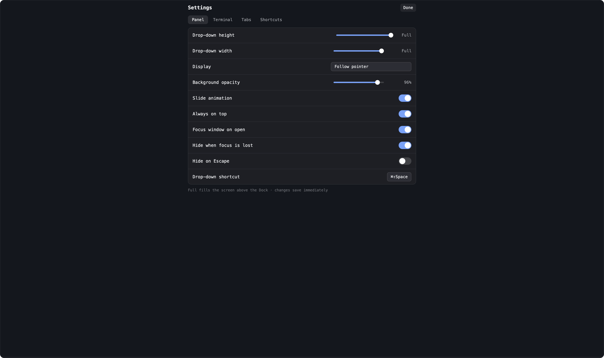

# sash

[](https://github.com/slashdash/sash/actions/workflows/ci.yml)

**A Quake-style drop-down terminal for macOS.** One hotkey slides a full-width
panel down over whatever you are doing. Tabs, split panes, search, scrollback
and a menu-bar home — no Dock icon.


Sash is built with [Rune](https://github.com/anomalyco/rune) (GPU UI, menu-bar
item, global shortcut, window plumbing) and
[libghostty-vt](https://lib.ghostty.org/vt/) (Ghostty's terminal emulation core).
Rune draws the frame; libghostty-vt owns every byte of terminal state.

> **Status: 0.1.0, pre-1.0.** Test builds are ad-hoc signed, not notarized, and
> macOS asks each machine to approve them once. See [Install](#install).

## Features

### Panel

- Drops from the physical top edge of the display in 140 ms, with rounded
  corners — covering the menu bar, or hanging directly beneath it (Settings →
  Panel → Placement). Showing it takes the keyboard without pulling another app
  forward.
- Global hotkey, `⌘⇧Space` by default, registered through Carbon (no
  Accessibility permission). A conflict names the app that owns the chord.
- Lives in the menu bar as a ghost hanging from a ceiling bar: Show/Hide, New
  Tab, Settings, Quit, and the exact build number. Left-click toggles the panel
  and right-click opens the menu, or reverse that in Settings → Panel →
  Menu-bar click.
- Drag the bottom edge to resize, or `⌘⇧M` to fill the space above the Dock
  and back.
- Follows the pointer across displays, or stays on a chosen display and returns
  to it when it is plugged back in.

### Tabs

- `⌘T` new, `⌘⇧T` duplicate (a new tab in the current shell's live
  directory), `⌘⇧W` close, `⌘1`–`⌘9` select, `⌘⇧[` / `⌘⇧]` and
  `⌃Tab` / `⌃⇧Tab` cycle.
- Right-click a tab to rename, move, duplicate, colour, pin or close it; drag to
  reorder. A pinned tab shows a pin instead of × and refuses Close Tab until it
  is unpinned.
- Titles fall back to the folder name (`Home`, not `~`), and a manual name
  overrides the display while OSC titles keep flowing underneath.
- Tabs take their title's width with a 120 pt minimum, or divide the strip
  equally with `tabs_fill_width`. The active tab can be marked with a dot,
  underline, whole tab or coloured text.
- A hollow ring marks output you have not seen; a program's OSC 9;4 progress
  draws along the strip. With one unpinned tab the strip collapses; a pinned tab
  keeps it.
- The strip can sit above or below the grid. Names, directories, colours and
  pins come back after a relaunch.

### Panes

- `⌘D` splits right, `⌘⇧D` splits down, `⌘[` / `⌘]` move the keyboard
  between panes, and `⌘W` closes the focused pane.
- Each pane owns its own libghostty terminal and pty; Sash owns only the split
  tree, geometry and focus. Drag the divider between two panes to change the
  split, and press `⌘⇧Return` to zoom the focused pane and back.
- Split trees, ratios and the focused pane come back after a relaunch.
- A shell that exits (Ctrl-D or `exit`) takes its pane with it. The last pane
  closes the tab, and the last tab rolls the panel back up.

### Terminal

- A pty per pane running `$SHELL -l` (or `shell` from the config), 256-colour
  palette, bold/faint/inverse, block/bar/underline cursor, bracketed paste,
  mouse reporting, input-method preedit, and the Kitty keyboard protocol.
- Block elements and box-drawing characters are drawn as rectangles on the cell
  grid, so logos, progress bars and frames tile without seams.
- Drag to select, double-click for a word, triple-click for a line; `⌘C`
  copies, `⌘A` selects the screen, and `⌘`-click opens links including OSC 8
  hyperlinks. Pasting a file copied in Finder inserts its quoted path.
- 10,000 lines of scrollback by default, with a thin scrollbar, page scrolling
  and prompt-to-prompt jumps through OSC 133 marks.
- `⌘P` quick open searches tabs, actions, settings, the directories the open
  tabs are in, and a typed path (`file:line` opens at that line in VS Code or
  Cursor).
- OSC 9 / OSC 777 messages and command-finished notices reach Notification
  Center when the panel is not focused.
- The bell can be off, visual, audible or both (Settings → Terminal → Bell);
  visual is the default.
- Settings → Terminal → Shell integration appends guarded OSC 133 hooks to
  zsh, bash or fish, which turns on prompt jumps, command-finished notices and
  accurate working directories. It edits your rc file only when you press
  Install, and the script itself lives under the config directory.

### Safety

- A paste that spans lines asks before it reaches the shell; Return confirms,
  Escape cancels.
- OSC 52 clipboard writes are off by default; when enabled they are capped at
  1 MiB and stripped of control bytes.

## Install

There is no binary download yet. Sash is ad-hoc signed and cannot be notarized
without a Developer ID, and macOS blocks unnotarized apps, so releases stay
source-only until that changes — build it with the steps below.

A local build behaves the same way on first launch:

1. Drag `dist/Sash.app` into `/Applications` and launch it from there.
   (Launching from the build directory runs a temporary copy.)
2. When macOS says it cannot verify the app, open **System Settings → Privacy &
   Security**, scroll down, click **Open Anyway** next to Sash, authenticate and
   confirm. Terminal equivalent: `xattr -dr com.apple.quarantine /Applications/Sash.app`.
3. Sash drops its panel down once, with a one-time welcome card, so you can see
   it is running. The ghost appears in the menu bar; there is no Dock icon.

The build number is shown in Settings and the menu-bar menu — quote it in a bug
report. Logs go to `~/Library/Logs/Sash/sash.log`.

### Uninstall

Quit Sash from the ghost menu, drag it to the Trash, then optionally remove
`~/.config/sash` and `~/Library/Logs/Sash`. If you installed shell integration,
remove the marked `sash shell integration` block from your `.zshrc`,
`.bash_profile` or `config.fish`; the snippet itself is under the config
directory.

## Build from source

Requirements: macOS 12+, Rust 1.85+ (edition 2024), Zig 0.17+, and the Xcode
command-line tools.

```sh
git clone https://github.com/slashdash/sash.git
cd sash
scripts/fetch-libghostty.sh   # builds libghostty-vt 1.0.2 with Zig
cargo run --release           # the menu-bar item appears; press ⌘⇧Space
```

The first build compiles libghostty-vt (about a minute) and Rune from Cargo's
git cache, so give it a few minutes. Rune is pre-release and pinned to a `dev`
revision in `Cargo.toml`; libghostty-vt is the stable `vt-1.0.2` source.

App bundles and test images:

```sh
scripts/bundle.sh              # dist/Sash.app (LSUIElement, ad-hoc signed)
scripts/bundle.sh --universal  # arm64 + x86_64
scripts/package.sh             # dist/Sash-<version>-<date>.dmg
```

## Command line

The app binary doubles as a small client. With no arguments it starts the
menu-bar app; with a command it talks to the running instance and exits, so it
works from Finder, editors, scripts and other terminals:

```sh
SASH="$HOME/Applications/Sash.app/Contents/MacOS/sash"
"$SASH" open ~/src/project   # new tab in that directory
"$SASH" .                    # shorthand for open the current directory
"$SASH" run make test        # new tab that runs the command at its first prompt
"$SASH" new-tab ~/src/other
"$SASH" toggle
"$SASH" settings
```

`open` accepts a directory or a file (the file opens in its parent directory).
The commands travel over a distributed notification guarded by a token in
`~/.config/sash/ipc-token`; there is no listening port. A relative path is
resolved against the caller's directory before it is sent.

## Keyboard shortcuts

| Shortcut | Action |
| --- | --- |
| `⌘⇧Space` | Show or hide the panel |
| `⌘,` | Settings |
| `⌘P` | Quick open |
| `⌘F` | Find |
| `⌘G` / `⇧⌘G` | Older / newer match |
| `⌘T` | New tab |
| `⌘⇧T` | Duplicate tab in the same directory |
| `⌘⇧W` | Close tab |
| `⌘1`–`⌘9` | Select tab |
| `⌘⇧[` / `⌘⇧]` | Previous / next tab |
| `⌃Tab` / `⌃⇧Tab` | Cycle tabs |
| `⌘D` / `⌘⇧D` | Split right / down |
| `⌘⇧Return` | Zoom the focused pane |
| `⌘[` / `⌘]` | Focus previous / next pane |
| `⌘W` | Close pane |
| `⌘⇧M` | Maximize or restore the panel |
| `⌘C` / `⌘A` / `⌘V` | Copy / select all / paste |
| `⌘↑` `⌘↓` | Scroll a page |
| `⌘PageUp` `⌘PageDown` | Scroll a page |
| `⌘Home` / `⌘End` | Top / bottom of scrollback |
| `⇧⌘↑` / `⇧⌘↓` | Jump between prompts |
| `⌘+` / `⌘-` | Font size |
| `⌘H` | Hide |
| `⌘Q` | Quit |

## Configuration

`~/.config/sash/config.json` is written with defaults on first run. Settings
edits it live; the file is read at launch. The full default:

```json
{
  "hotkey": "cmd+shift+space",
  "height": null,
  "width": null,
  "display": null,
  "panel_placement": "screen_top",
  "menu_bar_click": "toggle",
  "tabs_at_bottom": false,
  "tabs_fill_width": false,
  "tab_highlight": "whole_tab",
  "font_family": null,
  "font_size": 13.0,
  "opacity": 0.96,
  "animation_ms": 140,
  "bell": "visual",
  "shell": null,
  "hide_on_escape": false,
  "always_on_top": true,
  "focus_on_open": true,
  "hide_on_blur": true,
  "scrollback_lines": 10000,
  "copy_on_select": false,
  "clipboard_write": false,
  "confirm_multiline_paste": true,
  "desktop_notifications": true,
  "confirm_close": true,
  "restore_session": true,
  "welcome_seen": false
}
```

| Key | Default | Meaning |
| --- | --- | --- |
| `hotkey` | `"cmd+shift+space"` | Global chord; needs ⌘, ⌃ or ⌥ |
| `height` | `null` | Panel height in points; `null` fills from the physical top to the Dock |
| `width` | `null` | Panel width in points; `null` is the full display |
| `display` | `null` | 1-based display number; `null` follows the pointer |
| `panel_placement` | `"screen_top"` | `screen_top` covers the menu bar; `below_menu_bar` starts under it |
| `menu_bar_click` | `"toggle"` | `toggle` left-click shows/hides the panel; `menu` opens the menu |
| `tabs_at_bottom` | `false` | Put the tab strip below the grid |
| `tabs_fill_width` | `false` | Divide the strip equally instead of title-sized tabs |
| `tab_highlight` | `"whole_tab"` | `dot`, `underline`, `whole_tab` or `text` |
| `font_family` | `null` | System monospaced font, or a name / CSS-style fallback list |
| `font_size` | `13.0` | Terminal font size in points |
| `opacity` | `0.96` | Background opacity, 0.0–1.0 |
| `animation_ms` | `140` | Slide animation length |
| `bell` | `"visual"` | `off`, `visual`, `audible` or `both` |
| `shell` | `null` | Shell to run; `null` uses `$SHELL` |
| `hide_on_escape` | `false` | Hide the panel on Escape (vim needs Escape) |
| `always_on_top` | `true` | Also raise the panel above menu-bar status items |
| `focus_on_open` | `true` | Give the panel the keyboard when it drops down |
| `hide_on_blur` | `true` | Hide when another window takes the keyboard |
| `scrollback_lines` | `10000` | Rows kept per tab; `null` means no limit |
| `copy_on_select` | `false` | Copy as soon as a drag ends |
| `clipboard_write` | `false` | Allow OSC 52 / iTerm2 / Kitty clipboard writes |
| `confirm_multiline_paste` | `true` | Ask before a paste runs more than one command |
| `desktop_notifications` | `true` | Let OSC 9 / OSC 777 reach Notification Center |
| `confirm_close` | `true` | Ask before closing while a command runs |
| `restore_session` | `true` | Reopen the last tabs, names, colours and pins |
| `welcome_seen` | `false` | The one-time first-run card has been dismissed |

Details that do not fit a table:

- **`height` and `width`.** The settings slider writes a fraction of the usable
  screen and snaps to Full at the right end. A legacy default height of exactly
  `420` from an older config is migrated to Full once.
- **`display`.** Numbered from 1, with the menu-bar display first and the rest
  left to right. A pinned display that is unplugged falls back to the menu-bar
  display and is reclaimed when it returns.
- **`panel_placement`.** `screen_top` covers the menu bar; `below_menu_bar`
  leaves it visible, and Full height shrinks by the menu bar's height.
- **`menu_bar_click`.** The default `toggle` makes left-click show/hide the
  panel and leaves the menu on right-click. `menu` restores the menu-bar
  convention, so left-click opens the menu too.
- **`bell`.** Off ignores bells; visual flashes the tab chip; audible plays the
  system alert; both does both. Inactive tabs still get the unread ring.
- **`tabs_fill_width`.** Off keeps title-sized tabs with a 120 pt minimum.
- **Titles.** Directory-only titles show the folder name; a manual name wins.
- **`clipboard_write`.** Writes are capped at 1 MiB and stripped of control
  bytes other than tab and newline.
- **`scrollback_lines`.** `null` shows as 10,000 in the slider and means no
  line limit; libghostty-vt's 10 KB byte default is lifted either way.
- **`welcome_seen`.** Delete the config to see the first-run card again.



The settings page groups everything into Panel, Terminal, Tabs and Shortcuts.
The shortcut button listens for the next chord (`Esc` cancels and restores the
old one), the font field commits after a pause or Return, and every toggle
applies before the click is over.

## Development

```sh
cargo test
cargo fmt --check
cargo clippy --all-targets
```

The suite runs without a window: VT parsing and colours, OSC 7/8/9/52/133,
scrollback, search, prompt jumps, mouse encoding, selection, paste shaping,
config clamping and migration, session round-trips, split layout, and real pty
round-trips.

Headless snapshots (also good for screenshots):

```sh
SASH_DEMO=1 SASH_SHOW=1 cargo run -- --snap demo.png --at 1.0
SASH_DEMO=1 SASH_SETTINGS=1 cargo run -- --snap settings.png --at 1.0
SASH_COMMAND=cat cargo run -- --script scripts/demo.json --snap keys.png --at 1.0
XDG_CONFIG_HOME=/tmp/sash-cfg cargo run -- --script scripts/settings.json --tree /tmp/tree.json --at 2.0
```

Development variables: `SASH_SHOW=1` opens the panel at launch,
`SASH_SETTINGS=1` opens settings, `SASH_PASTE='line one
line two'` opens the
paste confirmation, `SASH_NO_TRAY=1` skips the menu-bar item, and
`SASH_COMMAND` replaces the login shell in debug builds. Scripts can drive
`wheel`, `drag`, `click`, `focus` and `paste` events.

Session state lives in `~/.config/sash/session.json`. It is written when a pane
or tab closes and on quit, and removed when the last tab closes.

Module layout, the poll loop, display placement and the rendering model are in
[`docs/architecture.md`](docs/architecture.md); decisions with real trade-offs
are recorded in [`docs/adr/`](docs/adr/).

## Limitations

- macOS only; the panel geometry and tray are AppKit-specific.
- Shell integration is opt-in. Settings → Terminal → Shell integration installs
  OSC 133 hooks for zsh, bash or fish; without them, prompt jumps and
  command-finished notices stay off.
- No drag-and-drop file paste or scrollback export.
- A resolution change while the panel is already down waits for the next show.
- libghostty-vt is the terminal core, not the full Ghostty renderer: ligatures,
  images and the GPU glyph pipeline are Rune's and Sash's own work.

## Troubleshooting

| Symptom | Check |
| --- | --- |
| App will not launch | System Settings → Privacy & Security → **Open Anyway**, or `xattr -dr com.apple.quarantine /Applications/Sash.app` |
| Hotkey types a character or switches input source | Rebind it in Settings → Shortcuts |
| Panel does not appear | Look for the ghost in the menu bar; another app may own the chord |
| Unexpected behaviour | `~/Library/Logs/Sash/sash.log` and the build number from Settings |

## Contributing

Bug reports and pull requests are welcome — see
[`CONTRIBUTING.md`](CONTRIBUTING.md). Report vulnerabilities privately as
described in [`SECURITY.md`](SECURITY.md); this project follows the
[Contributor Covenant](CODE_OF_CONDUCT.md).

## Licence

Sash is [MIT licensed](LICENSE), copyright 2026 Sash contributors. Every
dependency licence and its full text is in [`THIRD-PARTY.html`](THIRD-PARTY.html),
generated by `cargo about generate about.hbs` from `Cargo.lock`. The packaged app
carries the same notices in `Contents/Resources/Third-Party Notices.html`.

## Acknowledgements

- [Ghostty](https://ghostty.org) and its libghostty-vt 1.0.2 terminal core (MIT).
- [Rune](https://github.com/anomalyco/rune) for the UI, window and tray layer (MIT).
- The drop-down conventions this borrows from Guake, Yakuake and iTerm2's hotkey
  window.
