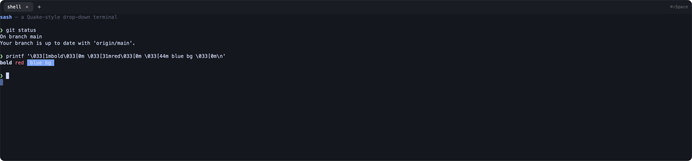

# sash



A Quake-style drop-down terminal for macOS. One hotkey slides a full-width panel
down from the top of the screen, whichever app you're in; it has the tab model
you'd expect from guake/yakuake, and lives in the menu bar.

Built with [Rune](https://github.com/anomalyco/rune) (GPU UI, menu-bar item,
global shortcuts, window/panel plumbing) and
[libghostty-vt](https://lib.ghostty.org/vt/) (Ghostty's terminal emulation
core). Rune is the shell and renderer; libghostty-vt owns every byte of terminal
state — parsing, grids, styles, cursor, modes and key encoding.

## What it does

- **Drop-down panel.** Non-activating `NSPanel` at the top edge, floating above
  other windows, revealed by a 140 ms curtain animation and rounded corners.
  Showing it takes the keyboard without pulling the whole app forward.
- **Global hotkey.** Default `⌘⇧Space`, registered with Carbon through Rune
  (no Accessibility permission). Change it in the settings page; a conflict
  names the app that owns the chord, and the tray still works.
- **Menu-bar extra.** Terminal glyph as a template image; menu has Show, New
  Tab, Settings and Quit.
- **Settings page.** Click the gear in the tab bar, press `⌘,`, or choose
  Settings from the menu-bar menu. Height and width sliders (Full by default),
  font family and size, opacity, scrollback, the slide animation, the global
  shortcut, the shell path, and every behaviour toggle live here. Changes apply
  live and are written to `config.json`; the font field commits after a pause or
  Return.
- **Tabs.** `⌘T` new, `⌘D` duplicate (a new tab in the current shell's live
  directory), `⌘W` close (with a confirmation while a command runs), `⌘1`–`⌘9`
  select, `⌘[` / `⌘]` and `⌃Tab` / `⌃⇧Tab` cycle. Titles follow the shell's OSC title and fall
  back to the shell name; a dot marks output you have not seen, and a program's
  OSC 9;4 progress draws under the tab.
- **Real terminal.** A pty per tab running `$SHELL -l` (or `shell` from the
  config), 256-colour palette, bold/faint/inverse, block/bar/underline cursor,
  bracketed paste on `⌘V`, mouse reporting for programs that ask (left, right,
  middle, back/forward and wheel; hold Shift to select instead), input-method
  preedit and commits, and the Kitty keyboard protocol's encodings (Rune's keys
  go through libghostty's encoder, which follows the program's modes).
- **Selection and copy.** Drag to select, double-click for a word, triple-click
  for a line; `⌘C` copies and `⌘A` selects the screen. `⌘`-click opens links,
  including OSC 8 hyperlinks. `copy_on_select` copies as soon as the drag ends.
  OSC 52 writes from programs (tmux over ssh, for one) reach the macOS clipboard
  only when `clipboard_write` is enabled. Pasting a file copied in Finder inserts
  its quoted path.
- **Scrollback.** Wheel and trackpad scroll up to 10,000 lines by default, with
  a thin scrollbar at the right; `⌘↑`/`⌘↓`, `⌘PageUp`/`⌘PageDown`,
  `⌘Home`/`⌘End` move by a page or to either end. Typing returns to the prompt.
- **Search.** `⌘F` opens a find bar over the grid; it searches the screen and
  the whole scrollback, counts matches, highlights the selected one, and scrolls
  it into view. Return / `⌘G` go older, Shift+Return / `⇧⌘G` newer, Escape closes.
- **Shell integration.** OSC 133 prompt marks turn `⌘⇧↑`/`⌘⇧↓` into jumps between
  commands, and a finished command can notify through Notification Center when
  the panel is not focused.
- **Quake behaviour.** The panel hides when it loses keyboard focus (toggleable),
  hides on Escape if you ask it to, and follows the pointer across displays the
  next time it drops down. Tabs and their directories come back on the next
  launch (toggleable).
- **Notifications.** Bell, unseen-output dots, OSC 9 / OSC 777 desktop messages,
  and OSC 133 command-finished notices through Notification Center when the panel
  is not in front.
- **Paste safety.** A paste that spans lines asks before it reaches the shell;
  Return confirms, Escape cancels.
- **Full-screen width** by default, placed just under the menu bar; `width` is
  configurable.

## Settings


Open it from the gear, `⌘,`, or the menu-bar menu. Height and width are
fractions of the usable screen and snap to Full at the right end; font family,
font size, opacity and scrollback update the live terminal. The shortcut button
starts listening for the next chord (`Esc` cancels and restores the old one), the
shell field writes through as you type, the font field commits after a pause or
Return, and every toggle applies before the click is over. The cards scroll when the panel is shorter than the controls.

## Build

```sh
scripts/fetch-libghostty.sh   # prebuilt libghostty-vt 1.1.0-dev+27ffca0 (pinned checksum)
cargo run --release           # menu-bar item appears; press ⌘⇧Space
```

To get a real app bundle:

```sh
scripts/bundle.sh             # dist/Sash.app (LSUIElement, ad-hoc signed)
open dist/Sash.app
```

Requirements: macOS 12+, Rust 1.85+ (edition 2024). Rune is pre-release and
pinned to a `dev` revision in `Cargo.toml`; the first build compiles it from
Cargo's git cache and takes a few minutes.

## Config

`~/.config/sash/config.json` is written with defaults on first run:

```json
{
  "hotkey": "cmd+shift+space",
  "height": null,
  "width": null,
  "font_family": null,
  "font_size": 13.0,
  "opacity": 0.96,
  "animation_ms": 140,
  "shell": null,
  "hide_on_escape": false,
  "always_on_top": true,
  "focus_on_open": true,
  "hide_on_blur": true,
  "scrollback_lines": 10000,
  "copy_on_select": false,
  "clipboard_write": false,
  "confirm_multiline_paste": true,
  "desktop_notifications": true,
  "confirm_close": true,
  "restore_session": true
}
```

`height: null` fills the usable screen from the menu bar down to the Dock; a
number is a height in points. The settings slider writes either a percentage of
that usable height or `null` for Full. `width: null` means the full display
width. `hide_on_escape` is off by default because vim needs Escape — hide with
the hotkey or `⌘H` instead. `hide_on_blur` hides the panel as soon as another
window takes the keyboard, the Quake reflex. `always_on_top` keeps the panel
floating above other windows; `focus_on_open` gives it the keyboard when it
drops down (off shows the panel without taking focus from the current app).
`scrollback_lines` keeps that many rows per tab (`null` means no line limit);
libghostty-vt's 10 KB byte default is lifted either way. `null` shows as 10,000
in the settings slider; dragging it writes a finite limit. `copy_on_select`
copies as soon as a drag ends; `clipboard_write` lets programs replace the
clipboard through OSC 52, iTerm2 or Kitty sequences (off by default; a write is
capped at 1 MiB and control bytes other than tab/newline are stripped);
`confirm_multiline_paste` asks before a paste would run more than one command; `desktop_notifications` lets OSC 9 / OSC 777 and
command-finished notices reach Notification Center. `font_family: null` uses the
system monospaced font; a name or CSS-style fallback list such as
`"JetBrains Mono, Menlo"` picks another. `confirm_close` asks before a tab or
the app goes while a command still runs, and `restore_session` reopens the last
tabs in their directories. The config is read at launch; the settings page
updates it live. A `height` of exactly `420` from an older config is migrated to
Full once, and saves include the newer keys.

## Architecture

| File | Role |
| --- | --- |
| `src/term.rs` | `Vt`: libghostty-vt terminal, render state, dirty-row grid snapshots, colours, cursor, scrollback, search, mouse encoding, effects callbacks (bell, pwd, clipboard, notifications, progress, OSC 133), paste modes |
| `src/term/keys.rs` | Rune `KeyEvent` → `GhosttyKeyEvent` → pty bytes via libghostty's encoder |
| `src/term/pty.rs` | portable-pty session, reader thread → channel, writer, resize, live pid/cwd, foreground job detection |
| `src/term/cwd.rs` | `proc_pidinfo` fallback for a shell's live directory (zsh emits no OSC 7 by default) |
| `src/selection.rs` | drag/word/line selection over the grid, copy text with trailing-space trimming |
| `src/textops.rs` | link detection, shell quoting, bracketed-paste shaping, wheel-pixel to row accumulation |
| `src/app.rs` | `Sash` state, tabs, selection, find, confirm and paste UI, effects, session save/restore, display placement, slide animation clock, the Rune view (tab bar + grid runs + settings page) |
| `src/tray.rs` | `NSStatusItem` through `tray-icon`, with a generated template glyph |
| `src/macos.rs` | `NSScreen` geometry: menu-bar inset, usable height above the Dock, display size, backing scale, and the screen under the pointer |
| `src/lib.rs` | AppSpec wiring: panel options, global shortcut, poll loop, key routing |

Rendering is a grid of absolutely positioned runs: one background quad per
same-colour span, one text element per same-style span, plus a cursor quad. The
view is rebuilt from the VT snapshot, and libghostty-vt tells us which rows are
dirty, so a quiet terminal costs almost nothing per frame.

`poll` drains every tab's pty, writes replies (device attributes, cursor
position reports) back to the pty, refreshes the grid and advances the reveal.
Each tab's pty reader thread calls `AppHandle::wake` as bytes arrive, so shell
output is drained and painted on the next frame instead of waiting for another
keystroke or an idle tick. Rune places the window on the pointer's display when
the panel opens and it stays there; the view clips the panel to the animated
height, so the tab bar appears first and the grid unrolls beneath it. While the reveal is moving, `poll` asks for the next frame with
`Tx::wake_after(Duration::ZERO)`; without that request the native loop goes to
rest after the first few frames and the curtain freezes part-way down, leaving
the hide unable to finish.

Terminal rows are rebuilt from the grid each frame, so runs mount and unmount
constantly while a TUI redraws. Each run is keyed by row and column and uses
`Transition::none()`: Rune's default 0.2 s enter and 0.15 s exit fades would
otherwise smear a full-screen app, with old glyphs lingering where they used to
be. Terminal content is state, not an entrance.

The initial global shortcut is registered from `poll` after the window host
exists (a chord can't be grabbed before its event loop routing does), then the
settings page unregisters it while recording and registers the new chord. The
old chord is released first so pressing it can be recorded instead of toggling
the panel; cancelling with Escape re-registers the old one.

## Tests

```sh
cargo test
```

The suite runs without a window:

- libghostty-vt parses text, SGR bold and cursor positioning;
- OSC 7 becomes a decoded directory, OSC 9;4 a progress state, and OSC 9 a
  notification;
- OSC 8 gives a cell's hyperlink and OSC 133 reports a command's exit;
- scrollback keeps the configured history, scrolls up and back to the live viewport;
- search finds every match in the scrollback and selects a visible one;
- prompt marks jump the viewport by whole commands;
- a bell reports once;
- OSC 52 writes are denied unless allowed, capped at 1 MiB, and stripped of
  control bytes;
- mouse modes encode clicks and wheel notches as SGR sequences;
- selection ranges, word/line selection, copy trimming, URL detection, shell
  quoting, paste control-byte stripping and wheel accumulation are unit-tested;
- config values clamp to safe ranges, sessions round-trip, and saves are atomic
  with 0600 permissions;
- a fresh terminal paints on its first refresh, and key encoding reuses its text
  buffer;
- a real pty's output reaches the grid;
- bytes written to the pty reach the child and its reply reaches the grid;
- a foreground job in the pty is told apart from the shell at its prompt;
- a shell's directory comes back through `proc_pidinfo`;
- Rune key events encode to `a`, `\x03`, `\r`, `\x1b[A`, `\t`;
- the configured height clamps to the usable screen, and a captured chord
  (`shift+super+j`) round-trips through `config.json`;
- an older config's default `420` height migrates to Full once.

Headless render checks (also good for screenshots):

```sh
SASH_DEMO=1 SASH_SHOW=1 cargo run -- --snap demo.png --at 1.0
SASH_DEMO=1 SASH_SETTINGS=1 cargo run -- --snap settings.png --at 1.0
SASH_COMMAND=cat cargo run -- --script scripts/demo.json --snap keys.png --at 1.0
XDG_CONFIG_HOME=/tmp/sash-cfg cargo run -- --script scripts/settings.json --tree /tmp/tree.json --at 2.0
```

`scripts/demo.json` presses the registered global shortcut, types `echo hi` and
hits Return, so the snapshot shows the full input → pty → VT → render loop.
`scripts/tabs.json` adds two tabs with `⌘T` and types into the third.
`scripts/settings.json` opens the settings page, flips the two toggles and
records `⇧⌘J` as the new shortcut; point `XDG_CONFIG_HOME` at a scratch
directory to see the written config without touching your own.

`SASH_SHOW=1` opens the panel at launch, `SASH_SETTINGS=1` opens the settings
page, and `SASH_PASTE=$'line one\nline two'` opens the paste confirmation (all
useful for demos and for checking a build without touching the hotkey);
`SASH_NO_TRAY=1` skips the menu-bar item. `SASH_COMMAND` replaces the login
shell with a command in debug builds (release ignores it), and scripts can drive `wheel`, `drag`, `click`, `focus`
and `paste` events, so scrollback, selection, mouse reporting and hide-on-blur
are checked without a hand.

Session state lives beside the config in `~/.config/sash/session.json`; it is
written when a tab closes and on quit, and removed when the last tab closes.

## Limitations

- macOS only for now (the panel geometry and tray path are AppKit-specific).
- Shell integration is not installed automatically. Prompt jumps and finished
  notices need the shell to send OSC 133 (Ghostty's zsh/fish/bash integration
  snippets do).
- No drag-and-drop file paste, split panes, scrollback export, or mouse-drag tab
  reordering yet.
- The panel follows the pointer when it opens, but a resolution change while it
  is already down waits for the next show.
- libghostty-vt is the terminal core, not the full Ghostty renderer:
  ligatures, images and the GPU glyph pipeline are ours/Rune's.
